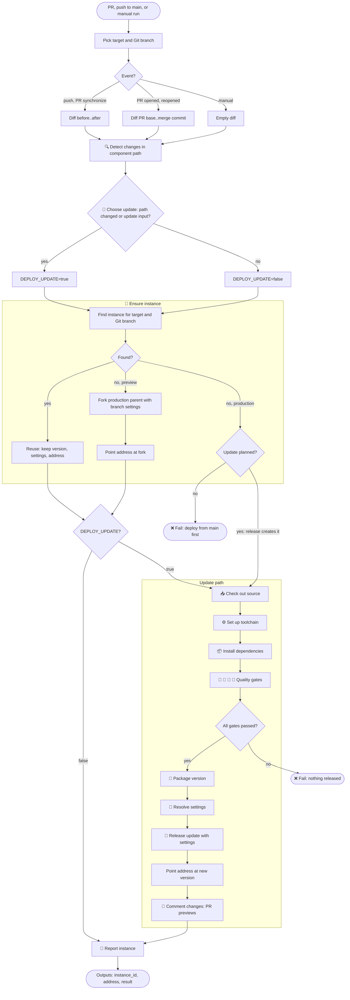
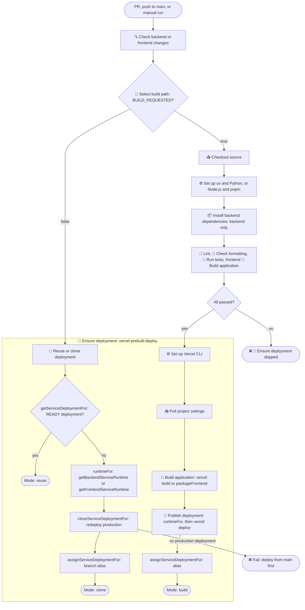

# Component workflow: unified terminology

> [!NOTE]
> Proposal only. Nothing here is implemented: the workflows, actions, provider helpers, and `CI.md` still use today's names. See [implementation order](#7-status-and-implementation-order).

The database, backend, and frontend workflows run the same logic. Only low-level provider helpers differ: Neon for the database, Vercel for the applications. Today the applications share one set of names and the database uses another.

## 1. Current terminology

| Concept                | Database today                                                                                  | Backend and frontend today                                                                                                                    | Differs | Proposed                                                                   |
| ---------------------- | ----------------------------------------------------------------------------------------------- | --------------------------------------------------------------------------------------------------------------------------------------------- | ------- | -------------------------------------------------------------------------- |
| Decision variable      | `BUILD_REQUESTED`, meaning migrate                                                              | `BUILD_REQUESTED`, meaning build                                                                                                              | meaning | `DEPLOY_UPDATE`                                                            |
| Manual input           | none; `database.yml` passes `build: true`                                                       | `build` checkbox, default `true`                                                                                                              | missing | `update` on all three                                                      |
| Decision step          | 🧭 Select migration path                                                                        | 🧭 Select build path                                                                                                                          | name    | 🧭 Choose update                                                           |
| Change path            | "migration path", 🚀 Apply migrations                                                           | "build path", `build` and `publish` operations, 🚀 Publish deployment                                                                         | name    | update, 🚀 Release update                                                  |
| Per-branch thing       | "preview branch" `preview/<branch>`                                                             | "preview deployment", "stable URL", "alias"                                                                                                   | name    | preview (an instance) at its address                                       |
| Immutable build        | none: migrated in place                                                                         | "deployment", deployment ID and URL                                                                                                           | —       | version                                                                    |
| Production source      | "production parent", `parent_branch_id`                                                         | "latest READY production deployment"                                                                                                          | name    | production parent                                                          |
| Selected thing         | "database reference", `branch_id`                                                               | "existing deployment", `deployment_id`                                                                                                        | name    | instance, `instance_id`                                                    |
| Keep as is             | log line "Reusing Neon branch"                                                                  | `reuse` operation and mode                                                                                                                    | name    | reuse                                                                      |
| Create from production | "Created Neon branch", `create: true`                                                           | `clone`, "redeploy"                                                                                                                           | name    | fork                                                                       |
| Settings               | "migration credentials", `database-env`                                                         | "runtime", "runtime bindings", `runtimeFor`                                                                                                   | name    | settings                                                                   |
| Instance steps         | 🌱 Ensure preview branch, 🔗 Resolve production parent, 🧭 Select database reference; every run | 🔗 Reuse or clone deployment; no-build runs only                                                                                              | shape   | 🌱 Ensure instance; every run                                              |
| Composite action       | `neon-operation`: `database-branch`, `database-plan`, `database-env`                            | `vercel-prebuilt-deploy`: `reuse`, `pull`, `build`, `publish`                                                                                 | shape   | `component-instance`: `ensure`, `package`, `settings`, `release`, `report` |
| Provider helpers       | `getProductionDatabase`, `getDatabasePreviewFor`, `getDatabaseConnectionFor`                    | `getServiceDeploymentFor`, `cloneServiceDeploymentFor`, `assignServiceDeploymentFor`, `getBackendServiceRuntime`, `getFrontendServiceRuntime` | name    | see [helper names](#4-helper-names)                                        |
| Job environment        | no `COMPONENT`                                                                                  | `COMPONENT`                                                                                                                                   | missing | `COMPONENT` in all three                                                   |
| Workflow output        | `branch_id`                                                                                     | `url`; the step also sets `deployment_id`                                                                                                     | name    | `instance_id`, `address`, `result`                                         |
| GitHub environment     | `database-<branch>`, no URL                                                                     | `<component>-<branch>`, URL from `url`                                                                                                        | shape   | unchanged; URL from `address`                                              |
| Job summary            | "Database deployment": Neon branch, Migrations                                                  | "`<component>` deployment": Target, Mode (`reuse`, `clone`, `build`), Deployment, URL                                                         | shape   | one format, see 📝 Report instance                                         |

## 2. Proposed vocabulary

Generic code, step names, and summaries use only these terms. Provider words (Neon branch, deployment, alias, redeploy) appear only in low-level helpers.

| Term                | Meaning                                                                                                              | Neon (database)                                  | Vercel (backend, frontend)                                                                                                                                 |
| ------------------- | -------------------------------------------------------------------------------------------------------------------- | ------------------------------------------------ | ---------------------------------------------------------------------------------------------------------------------------------------------------------- |
| Component           | Deployable part with its own path, reusable workflow, GitHub environment, and provider                               | `database/`                                      | `backend/`, `frontend/`                                                                                                                                    |
| Target              | `preview` or `production`                                                                                            | same                                             | same                                                                                                                                                       |
| Git branch          | Source branch a preview belongs to; always "Git branch", never bare "branch"                                         | —                                                | —                                                                                                                                                          |
| Stack               | All three components' instances for one target and Git branch                                                        | —                                                | —                                                                                                                                                          |
| Instance            | Provider resource serving a component for one target and Git branch                                                  | Neon branch                                      | newest READY version for the project, target, and Git branch                                                                                               |
| Preview, production | The instance for a Git branch; the instance for `main`                                                               | `preview/<git-branch>`; the parent branch        | preview deployment; production deployment                                                                                                                  |
| Production parent   | The production instance a preview is forked from                                                                     | `NEON_PARENT_BRANCH_ID`, else the default branch | latest READY production deployment                                                                                                                         |
| Version             | Immutable build. Versioned providers replace the instance on update; in-place providers change it                    | none: migrations change the instance in place    | deployment (`dpl_…`) with its immutable URL                                                                                                                |
| Address             | Stable name derived from component, target, and Git branch; survives updates and re-forks                            | branch name                                      | alias: `<project>-preview-<hash>.vercel.app`, or `<project>.vercel.app`                                                                                    |
| Settings            | Target-specific variables, credentials included, for code that runs against the instance; never in build output      | direct `DATABASE_URL` for migrations             | deployment environment: backend pooled `DATABASE_URL`, `CORS_ALLOWED_ORIGINS`, `WEBAUTHN_ORIGIN`, `WEBAUTHN_RP_ID`; frontend `BACKEND_URL`, `FRONTEND_URL` |
| Dependency          | Component whose instance another component's settings need; if missing, fail with "run the X workflow first"         | none                                             | backend needs database; frontend needs backend                                                                                                             |
| Reservation         | Claiming a dependent's address before it has an instance, so settings can trust it                                   | none                                             | backend reserves the frontend alias, pointed at production                                                                                                 |
| Update              | Decision to apply changed source: validate, then release                                                             | migrate                                          | build and publish a version                                                                                                                                |
| Reuse               | Keep the found instance: no build, settings, or address change                                                       | existing branch                                  | existing deployment                                                                                                                                        |
| Fork                | Create a missing preview from the production parent, without a build, with the Git branch's settings, at its address | copy-on-write branch                             | redeploy of production with branch settings, then alias                                                                                                    |
| Release             | Make an update live at the address                                                                                   | `alembic upgrade head`, in place                 | `vercel deploy --prebuilt`, then alias                                                                                                                     |
| Result              | What a run did                                                                                                       | `reuse`, `fork`, `update`, or `fork+update`      | same                                                                                                                                                       |

In your terms: a _preview deployment_ is a **preview**, a _versioned deployment_ is a **version**, and a _stable URL_ or _alias_ is an **address**.

Retired as generic words: build (as the decision) becomes update; clone, redeploy, and create become fork; runtime, bindings, and credentials become settings; database reference becomes instance; publish and migrate become release. "Deployment" stays only for GitHub deployment jobs and Vercel helpers; "environment" only for GitHub environments, since Vercel's environment is our target.

| Shared name                      | Kind                         | Values                                   | Replaces                     |
| -------------------------------- | ---------------------------- | ---------------------------------------- | ---------------------------- |
| `COMPONENT`                      | job environment              | `database`, `backend`, `frontend`        | applications only            |
| `DEPLOY_TARGET`, `DEPLOY_BRANCH` | job environment              | unchanged                                | —                            |
| `DEPLOY_UPDATE`                  | exported by 🧭 Choose update | `true`, `false`                          | `BUILD_REQUESTED`            |
| `update`                         | reusable and manual input    | boolean; manual default `true`           | `build`                      |
| `instance_id`                    | output                       | `br-…` or `dpl_…`                        | `branch_id`, `deployment_id` |
| `address`                        | output                       | branch name, or `https://` alias         | `url`                        |
| `result`                         | output                       | `reuse`, `fork`, `update`, `fork+update` | summary Mode                 |

No caller reads today's workflow outputs: dependencies are found through provider lookups.

## 3. Step names

Every reusable workflow runs the same stages in the same order. A single-step stage uses the stage name as its step name. Plug-in stages hold component-specific steps that keep their own names and the stage's emoji.

| #   | Stage                             | Runs                     | Database                               | Backend                                                            | Frontend                                                             |
| --- | --------------------------------- | ------------------------ | -------------------------------------- | ------------------------------------------------------------------ | -------------------------------------------------------------------- |
| 1   | 🔍 Detect changes                 | every run                | `database/`                            | `backend/`                                                         | `frontend/`                                                          |
| 2   | 🧭 Choose update                  | every run                | same                                   | same                                                               | same                                                                 |
| 3   | 🌱 Ensure instance                | every run                | find or fork a Neon branch             | find or fork a deployment                                          | same as backend                                                      |
| 4   | 📥 Check out source               | update                   | same                                   | same                                                               | same                                                                 |
| 5   | ⚙️ Set up toolchain (plug-in)     | update                   | ⚙️ Set up uv and Python                | ⚙️ Set up uv and Python, ⚙️ Set up Vercel CLI                      | ⚙️ Set up Node.js and pnpm, ⚙️ Set up Vercel CLI                     |
| 6   | 📦 Install dependencies (plug-in) | update                   | `uv sync`                              | `uv sync`                                                          | done by pnpm setup                                                   |
| 7   | Quality gates (plug-in)           | update, unless cancelled | none                                   | 🧹 Lint, 🎨 Check formatting, 🧪 Run tests                         | 🧹 Lint, 🎨 Check formatting, 🧪 Run tests, 🔨 Build application     |
| 8   | 🔨 Package version (plug-in)      | update                   | none                                   | 📥 Pull project configuration, 🔨 Package version (`vercel build`) | 📥 Pull project configuration, 🔨 Package version (Build Output API) |
| 9   | 🔐 Resolve settings               | update                   | direct `DATABASE_URL`                  | backend settings; reserves the frontend address                    | frontend settings; needs the backend                                 |
| 10  | 🚀 Release update                 | update                   | `alembic upgrade head`                 | `vercel deploy --prebuilt`, point alias                            | same as backend                                                      |
| 11  | 📝 Comment changes (plug-in)      | update                   | 📝 Comment schema changes, PR previews | none                                                               | none                                                                 |
| 12  | 📝 Report instance                | every run                | same                                   | same                                                               | same                                                                 |

Settings are resolved after packaging, so they never reach build output. The report writes `<component> <target> for <git-branch>: <result> <instance_id> at <address>` and sets the outputs.

Proposed emoji conventions, replacing the list in `CI.md`:

- 🔍 change detection; 🧭 update decision; 🌱 instance (find, reuse, fork); 🔐 settings.
- 📥 checkout and pulls; ⚙️ tool setup; 📦 dependencies.
- 🧹 lint; 🎨 formatting; 🧪 tests; 🔨 builds and packaging.
- 🚀 release; 📝 comments and reports; ❌ failures.
- 🔗 is retired: resolution moves into 🌱 and 🔐.

| Where                    | Current step                                    | Proposed                                                                                                      |
| ------------------------ | ----------------------------------------------- | ------------------------------------------------------------------------------------------------------------- |
| all three workflows      | 🔍 Check database, backend, or frontend changes | 🔍 Detect changes                                                                                             |
| database                 | 🧭 Select migration path                        | 🧭 Choose update                                                                                              |
| backend, frontend        | 🧭 Select build path                            | 🧭 Choose update                                                                                              |
| database                 | 🌱 Ensure preview branch                        | 🌱 Ensure instance                                                                                            |
| database                 | 🔗 Resolve production parent                    | folded into 🌱 Ensure instance for production runs and forks; the schema diff defaults to the branch's parent |
| database                 | 🧭 Select database reference                    | folded into 🌱 Ensure instance (`instance_id`)                                                                |
| database                 | 📥 Checkout migration source                    | 📥 Check out source                                                                                           |
| backend, frontend        | 📥 Checkout source                              | 📥 Check out source                                                                                           |
| database, backend        | ⚙️ Set up uv and Python                         | unchanged; plugs into ⚙️                                                                                      |
| frontend                 | ⚙️ Set up Node.js and pnpm                      | unchanged; plugs into ⚙️ and 📦                                                                               |
| database                 | 📦 Install migration tools                      | 📦 Install dependencies                                                                                       |
| backend                  | 📦 Install backend dependencies                 | 📦 Install dependencies                                                                                       |
| backend, frontend        | 🧹 Lint, 🎨 Check formatting, 🧪 Run tests      | unchanged; quality gates                                                                                      |
| frontend                 | 🔨 Build application (`ng build`)               | unchanged; quality gate                                                                                       |
| database                 | 🔐 Resolve migration credentials                | 🔐 Resolve settings                                                                                           |
| database                 | 🚀 Apply migrations                             | 🚀 Release update                                                                                             |
| database                 | 📝 Comment schema changes                       | unchanged; plugs into 📝                                                                                      |
| database                 | 📝 Write deployment summary                     | 📝 Report instance                                                                                            |
| backend, frontend        | 🚀 Ensure deployment (composite call)           | removed: its operations become stages 3, 5, 8, 9, 10, and 12                                                  |
| `vercel-prebuilt-deploy` | 🔗 Reuse or clone deployment                    | 🌱 Ensure instance                                                                                            |
| `vercel-prebuilt-deploy` | ⚙️ Set up Vercel CLI                            | unchanged; plugs into ⚙️                                                                                      |
| `vercel-prebuilt-deploy` | 📥 Pull project settings                        | 📥 Pull project configuration, since settings now means runtime settings                                      |
| `vercel-prebuilt-deploy` | 🔨 Build application                            | 🔨 Package version, no longer sharing the frontend gate's name                                                |
| `vercel-prebuilt-deploy` | 🚀 Publish deployment                           | 🔐 Resolve settings, then 🚀 Release update                                                                   |
| `neon-operation`         | 🔗 Resolve Neon resource                        | removed: `component-instance` operations                                                                      |
| `component-changes`      | 🔍 Check changed path                           | 🔍 Diff component path                                                                                        |
| `setup-vercel-cli`       | ⚙️ Set up Vercel CLI, ⚙️ Add Vercel CLI to PATH | unchanged                                                                                                     |

## 4. Helper names

Generic helpers name no provider. Neon helpers say `Database`, and Vercel helpers say `Service`, as today. The `For` suffix is dropped: every helper reads the target and Git branch from the same context.

| Generic                            | Neon helper (database)                                                       | Vercel helper (backend, frontend)                                  | Replaces                                                                                          |
| ---------------------------------- | ---------------------------------------------------------------------------- | ------------------------------------------------------------------ | ------------------------------------------------------------------------------------------------- |
| `findInstance()`                   | `findDatabaseBranch()`                                                       | `findServiceDeployment(projectId)`                                 | lookup half of `getDatabasePreviewFor`, `getServiceDeploymentFor`                                 |
| `findProductionParent()`           | `getProductionDatabaseBranch()`                                              | `latestServiceDeployment(projectId, 'production')`                 | `getProductionDatabase`                                                                           |
| `forkInstance(settings)`           | `forkDatabaseBranch(parentId)`                                               | `forkServiceDeployment(settings)`                                  | `getDatabasePreviewFor({ create: true })`, `cloneServiceDeploymentFor`                            |
| `resolveSettings()`                | `getDatabaseSettings()`, using `getDatabaseConnection({ branchId, pooled })` | `getBackendServiceSettings()`, `getFrontendServiceSettings()`      | `getDatabaseConnectionFor`, `getBackendServiceRuntime`, `getFrontendServiceRuntime`, `runtimeFor` |
| `reserveAddress()`                 | none                                                                         | `reserveServiceAlias(projectId)`                                   | inline code in `getBackendServiceRuntime`                                                         |
| `packageVersion()`                 | none                                                                         | `pullServiceConfig()`, `buildServiceOutput()`, `packageFrontend()` | `pull` and `build` operations                                                                     |
| `releaseUpdate(settings)`          | none: the Alembic step                                                       | `publishServiceDeployment(settings)`                               | `publish` operation                                                                               |
| `pointAddress(instance)`           | none: the branch name is the address                                         | `pointServiceAlias(deploymentId)`                                  | `assignServiceDeploymentFor`                                                                      |
| `addressFor()`                     | `databaseBranchName()`, giving `preview/<git-branch>`                        | `serviceAlias()`, `serviceAddress(projectId)`                      | inline Neon name, `serviceHostname`                                                               |
| `reportInstance(result, instance)` | shared                                                                       | shared                                                             | `report(mode)`, the database summary script                                                       |

Unchanged low-level helpers: `neonRequest`, `vercelRequest`, `latestServiceDeployment`, `ownedServiceAlias`, `assignServiceAlias`, and `serviceAlias`.

Composite actions:

- `component-changes` keeps its name and `changed` output.
- `neon-operation` and `vercel-prebuilt-deploy` merge into `component-instance`. Its `operation` input is `ensure`, `package`, `settings`, `release`, or `report`, dispatched on `COMPONENT`. The database uses `ensure`, `settings`, and `report`; its release is the Alembic step.
- `setup-vercel-cli` is unchanged.

## 5. Diagrams

### New: generic component flow

- `stack.yml` runs this flow for the database, then the backend, then the frontend. 🔐 Resolve settings and forks fail when a dependency has no instance.
- Target: the `target` input, else `production` on push, else `preview`. GitHub environment: `<component>-production` or `<component>-<git-branch>`.
- Neon forks need no settings, and its address is the branch name, so pointing the address is a no-op.

### Old: backend and frontend

### Old: database

## 6. New versus old

| Area                   | Old                                                                                           | New                                                                             | Behavior                      |
| ---------------------- | --------------------------------------------------------------------------------------------- | ------------------------------------------------------------------------------- | ----------------------------- |
| Decision               | `BUILD_REQUESTED`; "build path" or "migration path"                                           | `DEPLOY_UPDATE`; 🧭 Choose update                                               | same                          |
| Instance lookup        | database: first, in three steps; applications: last, inside the composite, no-build runs only | 🌱 Ensure instance: one step, third, every run                                  | applications: see question 1  |
| Create from production | database creates a branch; applications clone                                                 | fork                                                                            | same                          |
| Production parent      | database resolves it on every migrating run, for the schema diff                              | production runs and forks only; the schema diff defaults to the branch's parent | one Neon call fewer           |
| Settings               | database: own step; applications: inside 🚀 Publish deployment                                | 🔐 Resolve settings after packaging, in all three                               | same                          |
| Release                | 🚀 Apply migrations or 🚀 Publish deployment                                                  | 🚀 Release update                                                               | same                          |
| Address                | alias assigned inside clone and publish; implicit for the database                            | pointed after fork and release; a no-op for Neon                                | same                          |
| Composite actions      | `neon-operation`, `vercel-prebuilt-deploy`                                                    | `component-instance`                                                            | same                          |
| Outputs                | `branch_id` or `url`                                                                          | `instance_id`, `address`, `result`                                              | no caller reads them          |
| Summary                | two formats; modes `reuse`, `clone`, `build`                                                  | one format; results `reuse`, `fork`, `update`, `fork+update`                    | same                          |
| Manual input           | `build`, applications only                                                                    | `update`, all three                                                             | the database gains a checkbox |

In the diagrams, the old application flow decides first and looks up an instance only when it will not build. The old database looks up first. The new flow uses the database's order for every component, so its only behavior change is question 1.

### Open questions

1. **Fork before the first update?** The new flow forks a missing preview even when an update follows, as the database does today. This costs one no-build redeploy per changed application on a Git branch's first run, and it needs a READY production deployment. The alternative keeps today's application shortcut: versioned providers skip the fork when an update follows. That needs one provider property and a different `if:` per provider. Which do you prefer?
2. **Names.** Are instance, address, version, fork, update, release, and settings right? Alternatives: slot, alias, deployment, clone, build, publish, runtime.
3. **Database `update` checkbox.** Should `database.yml` get it, where unchecked only ensures the preview, or keep migrations forced?
4. **Database quality gate.** The database has none today. Add one, for example migrating a throwaway fork first, or leave the stage empty?
5. **Stale settings on reuse.** Reuse never rebinds settings. If the Neon branch is deleted and re-forked, a reused backend keeps the old `DATABASE_URL`; aliases are stable, so other settings are unaffected. Should a fork refresh downstream settings?
6. **Application PR comment.** Should 📝 Comment changes post the preview addresses for the backend and frontend?
7. **Backend job emoji.** `⚙️ Backend` reuses the ⚙️ tool-setup prefix. Change it?

## 7. Status and implementation order

Nothing above is implemented. Suggested order:

1. Rename only, with no behavior change: environment variables, inputs, outputs, step names, and the summary format.
2. Rename provider helpers and add the generic layer (`findInstance`, `forkInstance`, `resolveSettings`, `releaseUpdate`, `pointAddress`, `reportInstance`).
3. Merge `neon-operation` and `vercel-prebuilt-deploy` into `component-instance`, and expose its operations as workflow steps.
4. Apply the decision on question 1: move 🌱 Ensure instance before checkout in the application workflows.
5. Update `CI.md` (vocabulary and step-name conventions) and `AI.md`.
6. Verify with stack runs: a new Git branch with and without changes (`fork+update`, `fork`), later pushes with and without changes (`update`, `reuse`), a manual run with `update` unchecked, and a production push.
