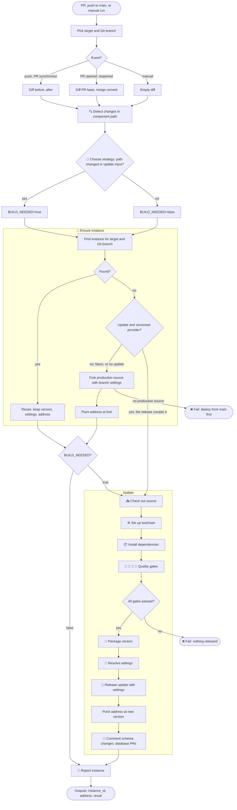
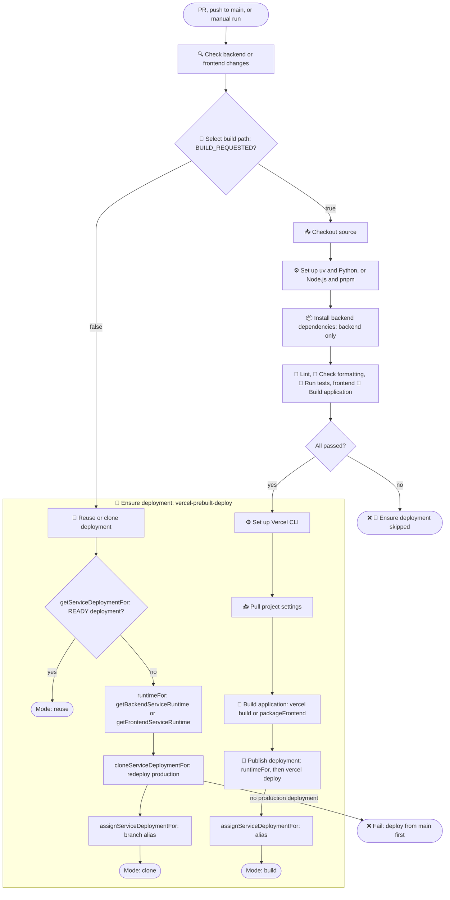
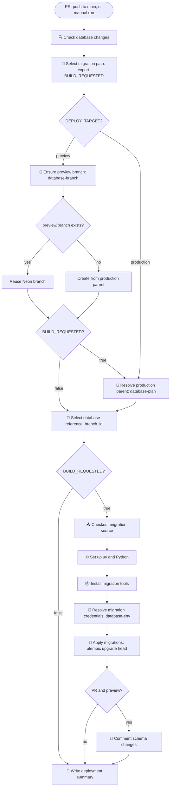

# Component workflow: unified terminology

> [!NOTE]
> Implemented. The names follow the PR review, and the [decisions](#decisions) record the answers to the proposal's open questions. [`CI.md`](CI.md) describes the architecture around this flow.

The database, backend, and frontend workflows run the same logic with the same step names. Only low-level provider helpers differ: Neon for the database, Vercel for the applications. Before this change, the applications shared one set of names and the database used another.

## 1. Old and new names

| Concept                | Database before                                                                                 | Backend and frontend before                                                                                                                   | Differed | Now                                                                                |
| ---------------------- | ----------------------------------------------------------------------------------------------- | --------------------------------------------------------------------------------------------------------------------------------------------- | -------- | ---------------------------------------------------------------------------------- |
| Decision variable      | `BUILD_REQUESTED`, meaning migrate                                                              | `BUILD_REQUESTED`, meaning build                                                                                                              | meaning  | `BUILD_NEEDED`                                                                     |
| Manual input           | none; `database.yml` passed `build: true`                                                       | `build` checkbox, default `true`                                                                                                              | missing  | `update` on all three                                                              |
| Decision step          | 🧭 Select migration path                                                                        | 🧭 Select build path                                                                                                                          | name     | 🧭 Choose strategy                                                                 |
| Change path            | "migration path", 🚀 Apply migrations                                                           | "build path", `build` and `publish` operations, 🚀 Publish deployment                                                                         | name     | update, 🚀 Release update                                                          |
| Per-branch thing       | "preview branch" `preview/<branch>`                                                             | "preview deployment", "stable URL", "alias"                                                                                                   | name     | preview (an instance) at its address                                               |
| Immutable build        | none: migrated in place                                                                         | "deployment", deployment ID and URL                                                                                                           | —        | version                                                                            |
| Production source      | "production parent", `parent_branch_id`                                                         | "latest READY production deployment"                                                                                                          | name     | production source                                                                  |
| Selected thing         | "database reference", `branch_id`                                                               | "existing deployment", `deployment_id`                                                                                                        | name     | instance, `instance_id`                                                            |
| Keep as is             | log line "Reusing Neon branch"                                                                  | `reuse` operation and mode                                                                                                                    | name     | reuse                                                                              |
| Create from production | "Created Neon branch", `create: true`                                                           | `clone`, "redeploy"                                                                                                                           | name     | fork                                                                               |
| Settings               | "migration credentials", `database-env`                                                         | "runtime", "runtime bindings", `runtimeFor`                                                                                                   | name     | settings                                                                           |
| Instance steps         | 🌱 Ensure preview branch, 🔗 Resolve production parent, 🧭 Select database reference; every run | 🔗 Reuse or clone deployment; no-build runs only                                                                                              | shape    | 🌱 Ensure instance; every run                                                      |
| Composite action       | `neon-operation`: `database-branch`, `database-plan`, `database-env`                            | `vercel-prebuilt-deploy`: `reuse`, `pull`, `build`, `publish`                                                                                 | shape    | `component-instance`: `ensure`, `pull`, `package`, `settings`, `release`, `report` |
| Provider helpers       | `getProductionDatabase`, `getDatabasePreviewFor`, `getDatabaseConnectionFor`                    | `getServiceDeploymentFor`, `cloneServiceDeploymentFor`, `assignServiceDeploymentFor`, `getBackendServiceRuntime`, `getFrontendServiceRuntime` | name     | see [helper names](#4-helper-names)                                                |
| Job environment        | no `COMPONENT`                                                                                  | `COMPONENT`                                                                                                                                   | missing  | `COMPONENT` in all three                                                           |
| Workflow output        | `branch_id`                                                                                     | `url`; the step also set `deployment_id`                                                                                                      | name     | `instance_id`, `address`, `result`                                                 |
| GitHub environment     | `database-<branch>`, no URL                                                                     | `<component>-<branch>`, URL from `url`                                                                                                        | shape    | unchanged; URL from `address`                                                      |
| Job summary            | "Database deployment": Neon branch, Migrations                                                  | "`<component>` deployment": Target, Mode (`reuse`, `clone`, `build`), Deployment, URL                                                         | shape    | one format, see 📝 Report instance                                                 |

## 2. Vocabulary

Generic code, step names, and summaries use only these terms. Provider words (Neon branch, deployment, alias, redeploy) appear only in low-level helpers.

| Term                | Meaning                                                                                                              | Neon (database)                                  | Vercel (backend, frontend)                                                                                                                                 |
| ------------------- | -------------------------------------------------------------------------------------------------------------------- | ------------------------------------------------ | ---------------------------------------------------------------------------------------------------------------------------------------------------------- |
| Component           | Deployable part with its own path, reusable workflow, GitHub environment, and provider                               | `database/`                                      | `backend/`, `frontend/`                                                                                                                                    |
| Target              | `preview` or `production`                                                                                            | same                                             | same                                                                                                                                                       |
| Git branch          | Source branch a preview belongs to; always "Git branch", never bare "branch"                                         | —                                                | —                                                                                                                                                          |
| Stack               | All three components' instances for one target and Git branch                                                        | —                                                | —                                                                                                                                                          |
| Instance            | Provider resource serving a component for one target and Git branch                                                  | Neon branch                                      | newest READY version for the project, target, and Git branch                                                                                               |
| Preview, production | The instance for a Git branch; the instance for `main`                                                               | `preview/<git-branch>`; the production source    | preview deployment; production deployment                                                                                                                  |
| Production source   | The production instance a preview is forked from                                                                     | `NEON_PARENT_BRANCH_ID`, else the default branch | latest READY production deployment                                                                                                                         |
| Version             | Immutable build. Versioned providers replace the instance on update; in-place providers change it                    | none: migrations change the instance in place    | deployment (`dpl_…`) with its immutable URL                                                                                                                |
| Address             | Stable name derived from component, target, and Git branch; survives updates and re-forks                            | branch name                                      | alias: `<project>-preview-<hash>.vercel.app`, or `<project>.vercel.app`                                                                                    |
| Settings            | Target-specific variables, credentials included, for code that runs against the instance; never in build output      | direct `DATABASE_URL` for migrations             | deployment environment: backend pooled `DATABASE_URL`, `CORS_ALLOWED_ORIGINS`, `WEBAUTHN_ORIGIN`, `WEBAUTHN_RP_ID`; frontend `BACKEND_URL`, `FRONTEND_URL` |
| Dependency          | Component whose instance another component's settings need; if missing, fail with "run the X workflow first"         | none                                             | backend needs database; frontend needs backend                                                                                                             |
| Reservation         | Claiming a dependent's address before it has an instance, so settings can trust it                                   | none                                             | backend reserves the frontend alias, pointed at production                                                                                                 |
| Update              | Decision to apply changed source: validate, then release                                                             | migrate                                          | build and publish a version                                                                                                                                |
| Reuse               | Keep the found instance: no build, settings, or address change                                                       | existing branch                                  | existing deployment                                                                                                                                        |
| Fork                | Create a missing preview from the production source, without a build, with the Git branch's settings, at its address | copy-on-write branch, also before an update      | redeploy of production with branch settings, then alias; only without an update                                                                            |
| Release             | Make an update live at the address                                                                                   | `alembic upgrade head`, in place                 | `vercel deploy --prebuilt`, then alias                                                                                                                     |
| Result              | What a run did                                                                                                       | `reuse`, `fork`, `update`, or `fork+update`      | `reuse`, `fork`, or `update`                                                                                                                               |

A _preview deployment_ is a **preview**, a _versioned deployment_ is a **version**, and a _stable URL_ or _alias_ is an **address**.

Retired as generic words: build (as the decision) becomes update; clone, redeploy, and create become fork; runtime, bindings, and credentials become settings; database reference becomes instance; production parent becomes production source; publish and migrate become release. "Deployment" stays only for GitHub deployment jobs and Vercel helpers; "environment" only for GitHub environments, since Vercel's environment is our target. "Fork" no longer means a forked repository: `CI.md` says "forked repositories" for those.

| Shared name                       | Kind                            | Values                                   | Replaces                     |
| --------------------------------- | ------------------------------- | ---------------------------------------- | ---------------------------- |
| `COMPONENT`                       | job environment                 | `database`, `backend`, `frontend`        | applications only            |
| `DEPLOY_TARGET`, `DEPLOY_BRANCH`  | job environment                 | unchanged                                | —                            |
| `BUILD_NEEDED`                    | exported by 🧭 Choose strategy  | `true`, `false`                          | `BUILD_REQUESTED`            |
| `update`                          | reusable and manual input       | boolean; manual default `true`           | `build`                      |
| `INSTANCE_ID`, `INSTANCE_ADDRESS` | exported by 🌱 and 🚀           | the instance the job is on               | step outputs                 |
| `INSTANCE_RESULT`                 | exported by 🌱 Ensure instance  | `reuse` or `fork`                        | summary Mode                 |
| `INSTANCE_SETTINGS`               | exported by 🔐 Resolve settings | names of the exported settings           | `runtimeFor` result          |
| `instance_id`                     | output                          | `br-…` or `dpl_…`                        | `branch_id`, `deployment_id` |
| `address`                         | output                          | branch name, or `https://` alias         | `url`                        |
| `result`                          | output                          | `reuse`, `fork`, `update`, `fork+update` | summary Mode                 |

No caller reads the workflow outputs: dependencies are found through provider lookups.

## 3. Step names

Every reusable workflow runs the same stages in the same order. A single-step stage uses the stage name as its step name. Plug-in stages hold component-specific steps that keep their own names.

| #   | Stage                             | Runs                     | Database                                  | Backend                                                                                  | Frontend                                                                                   |
| --- | --------------------------------- | ------------------------ | ----------------------------------------- | ---------------------------------------------------------------------------------------- | ------------------------------------------------------------------------------------------ |
| 1   | 🔍 Detect changes                 | every run                | `database/`                               | `backend/`                                                                               | `frontend/`                                                                                |
| 2   | 🧭 Choose strategy                | every run                | same                                      | same                                                                                     | same                                                                                       |
| 3   | 🌱 Ensure instance                | every run                | find or fork a Neon branch                | find a deployment; fork one only without an update                                       | same as backend                                                                            |
| 4   | 📥 Check out source               | update                   | same                                      | same                                                                                     | same                                                                                       |
| 5   | ⚙️ Set up toolchain (plug-in)     | update                   | ⚙️ Set up uv and Python                   | ⚙️ Set up uv and Python                                                                  | ⚙️ Set up Node.js and pnpm                                                                 |
| 6   | 📦 Install dependencies (plug-in) | update                   | `uv sync`                                 | `uv sync`                                                                                | done by pnpm setup                                                                         |
| 7   | Quality gates (plug-in)           | update, unless cancelled | none yet                                  | 🧹 Lint, 🎨 Check formatting, 🧪 Run tests                                               | 🧹 Lint, 🎨 Check formatting, 🧪 Run tests, 🔨 Build application                           |
| 8   | 🔨 Package version (plug-in)      | update                   | none                                      | ⚙️ Set up Vercel CLI, 📥 Pull project configuration, 🔨 Package version (`vercel build`) | ⚙️ Set up Vercel CLI, 📥 Pull project configuration, 🔨 Package version (Build Output API) |
| 9   | 🔐 Resolve settings               | update                   | direct `DATABASE_URL`                     | backend settings; reserves the frontend address                                          | frontend settings; needs the backend                                                       |
| 10  | 🚀 Release update                 | update                   | `alembic upgrade head`                    | `vercel deploy --prebuilt`, point alias                                                  | same as backend                                                                            |
| 11  | 📝 Comment changes (plug-in)      | update                   | 📝 Comment schema changes, on PR previews | none                                                                                     | none                                                                                       |
| 12  | 📝 Report instance                | every run                | same                                      | same                                                                                     | same                                                                                       |

- Settings are resolved after packaging, so they never reach build output.
- ⚙️ Set up Vercel CLI runs in stage 8, after the quality gates, because its `pnpm/setup` exports its own `PNPM_HOME` and puts it first on `PATH`.
- The report logs `<component> <target> for <git-branch>: <result> <instance_id> at <address>`, sets the outputs, and writes the job summary below. A failed `component-instance` operation writes the same heading with `Result: ❌ <operation> failed` and the error.

```md
### backend preview for `cd`

- Result: update
- Instance: `dpl_…`
- Address: https://rent-n-sail-backend-preview-56d0e81d9bdf.vercel.app
```

Emoji conventions, also listed in `CI.md`. Emojis stay name prefixes, and the `⚙️ Backend` job name is unchanged.

- 🔍 change detection; 🧭 strategy; 🌱 instance (find, reuse, fork); 🔐 settings.
- 📥 checkout and pulls; ⚙️ tool setup; 📦 dependencies.
- 🧹 lint; 🎨 formatting; 🧪 tests; 🔨 builds and packaging.
- 🚀 release; 📝 comments and reports; ❌ failures.
- 🔗 is retired: resolution moved into 🌱 and 🔐.

| Where                    | Step before                                     | Now                                                                                         |
| ------------------------ | ----------------------------------------------- | ------------------------------------------------------------------------------------------- |
| all three workflows      | 🔍 Check database, backend, or frontend changes | 🔍 Detect changes                                                                           |
| database                 | 🧭 Select migration path                        | 🧭 Choose strategy                                                                          |
| backend, frontend        | 🧭 Select build path                            | 🧭 Choose strategy                                                                          |
| database                 | 🌱 Ensure preview branch                        | 🌱 Ensure instance                                                                          |
| database                 | 🔗 Resolve production parent                    | removed: forks find the production source; the schema diff defaults to the preview's parent |
| database                 | 🧭 Select database reference                    | folded into 🌱 Ensure instance (`INSTANCE_ID`)                                              |
| database                 | 📥 Checkout migration source                    | 📥 Check out source                                                                         |
| backend, frontend        | 📥 Checkout source                              | 📥 Check out source                                                                         |
| database, backend        | ⚙️ Set up uv and Python                         | unchanged; plugs into ⚙️                                                                    |
| frontend                 | ⚙️ Set up Node.js and pnpm                      | unchanged; plugs into ⚙️ and 📦                                                             |
| database                 | 📦 Install migration tools                      | 📦 Install dependencies                                                                     |
| backend                  | 📦 Install backend dependencies                 | 📦 Install dependencies                                                                     |
| backend, frontend        | 🧹 Lint, 🎨 Check formatting, 🧪 Run tests      | unchanged; quality gates                                                                    |
| frontend                 | 🔨 Build application (`ng build`)               | unchanged; quality gate                                                                     |
| database                 | 🔐 Resolve migration credentials                | 🔐 Resolve settings                                                                         |
| database                 | 🚀 Apply migrations                             | 🚀 Release update                                                                           |
| database                 | 📝 Comment schema changes                       | unchanged; plugs into 📝                                                                    |
| database                 | 📝 Write deployment summary                     | 📝 Report instance                                                                          |
| backend, frontend        | 🚀 Ensure deployment (composite call)           | removed: its operations became stages 3, 8, 9, 10, and 12                                   |
| `vercel-prebuilt-deploy` | 🔗 Reuse or clone deployment                    | 🌱 Ensure instance                                                                          |
| `vercel-prebuilt-deploy` | ⚙️ Set up Vercel CLI                            | unchanged; plugs into 🔨 Package version                                                    |
| `vercel-prebuilt-deploy` | 📥 Pull project settings                        | 📥 Pull project configuration, since settings now means deployment settings                 |
| `vercel-prebuilt-deploy` | 🔨 Build application                            | 🔨 Package version, no longer sharing the frontend gate's name                              |
| `vercel-prebuilt-deploy` | 🚀 Publish deployment                           | 🔐 Resolve settings, then 🚀 Release update                                                 |
| `neon-operation`         | 🔗 Resolve Neon resource                        | removed: `component-instance` operations                                                    |
| `component-changes`      | 🔍 Check changed path                           | 🔍 Diff component path                                                                      |
| `setup-vercel-cli`       | ⚙️ Set up Vercel CLI, ⚙️ Add Vercel CLI to PATH | unchanged                                                                                   |

## 4. Helper names

The operations in `component-instance/instance.cjs` call only generic names. Each component maps them to helpers in `_shared/providers.cjs`: Neon helpers say `Database`, and Vercel helpers say `Service`. The `For` suffix is gone: every helper reads the target and Git branch from the same context, and every instance is `{ id, address }`.

| Generic           | Neon helper (database)                                         | Vercel helper (backend, frontend)                                                                   | Replaces                                                                                          |
| ----------------- | -------------------------------------------------------------- | --------------------------------------------------------------------------------------------------- | ------------------------------------------------------------------------------------------------- |
| `findInstance`    | `findDatabaseBranch()`                                         | `findServiceDeployment(projectId)`                                                                  | lookup half of `getDatabasePreviewFor`, `getServiceDeploymentFor`                                 |
| `forkInstance`    | `forkDatabaseBranch()`, from `getProductionDatabaseBranch()`   | `forkServiceDeployment(settings)`, from `latestServiceDeployment(projectId, 'production')`          | `getDatabasePreviewFor({ create: true })`, `getProductionDatabase`, `cloneServiceDeploymentFor`   |
| `resolveSettings` | `getDatabaseSettings()`, using `getDatabaseConnection(pooled)` | `getBackendServiceSettings()` with `reserveServiceAlias(projectId)`; `getFrontendServiceSettings()` | `getDatabaseConnectionFor`, `getBackendServiceRuntime`, `getFrontendServiceRuntime`, `runtimeFor` |
| `pullConfig`      | none                                                           | `pullServiceConfig()`                                                                               | `pull` operation                                                                                  |
| `packageVersion`  | none                                                           | backend `buildServiceOutput()`; frontend `packageFrontend()`                                        | `build` operation                                                                                 |
| `releaseUpdate`   | none: the Alembic step                                         | `publishServiceDeployment(settingNames)`, then `pointServiceAlias(url)`                             | `publish` operation, `assignServiceDeploymentFor`                                                 |
| `versioned`       | `false`: an update changes the instance, so it needs one first | `true`: a release creates the instance                                                              | the applications' build-first shortcut                                                            |

- Addresses: `databaseBranchName()` gives `preview/<git-branch>`; `serviceAddress(projectId)` (formerly `serviceHostname`) and `serviceAlias()` give the alias.
- Unchanged low-level helpers: `neonRequest`, `vercelRequest`, `latestServiceDeployment`, `ownedServiceAlias`, `assignServiceAlias`, and `serviceAlias`.
- The proposal's generic `findProductionSource`, `reserveAddress`, `pointAddress`, and `addressFor` stayed provider-internal: only provider helpers call them.

Composite actions:

- `component-changes` keeps its name and `changed` output.
- `neon-operation` and `vercel-prebuilt-deploy` merged into `component-instance`. Its `operation` input is `ensure`, `pull`, `package`, `settings`, `release`, or `report`, dispatched on `COMPONENT`. The database uses `ensure`, `settings`, and `report`; its release is the Alembic step.
- `setup-vercel-cli` is unchanged.

## 5. Diagrams

### Now: generic component flow



- `stack.yml` runs this flow for the database, then the backend, then the frontend. 🔐 Resolve settings and forks fail when a dependency has no instance.
- Target: the `target` input, else `production` on push, else `preview`. GitHub environment: `<component>-production` or `<component>-<git-branch>`.
- Neon is not versioned: a missing database preview is forked even before an update. Its address is the branch name, so pointing the address is a no-op.
- A versioned provider skips the fork when an update follows, because the release creates the instance. That also covers production's first deployment from `main`.

### Before: backend and frontend



### Before: database



## 6. Before and after

| Area                   | Before                                                                                        | Now                                                                             | Behavior                                                     |
| ---------------------- | --------------------------------------------------------------------------------------------- | ------------------------------------------------------------------------------- | ------------------------------------------------------------ |
| Decision               | `BUILD_REQUESTED`; "build path" or "migration path"                                           | `BUILD_NEEDED`; 🧭 Choose strategy                                              | same                                                         |
| Instance lookup        | database: first, in three steps; applications: last, inside the composite, no-build runs only | 🌱 Ensure instance: one step, third, every run                                  | applications also look up before an update: one Vercel query |
| Create from production | database creates a branch; applications clone                                                 | fork; applications fork only without an update                                  | same                                                         |
| Production source      | database resolves it on every migrating run, for the schema diff                              | resolved for forks; the schema diff defaults to the preview's parent            | same                                                         |
| Settings               | database: own step; applications: inside 🚀 Publish deployment                                | 🔐 Resolve settings after packaging, in all three                               | same                                                         |
| Release                | 🚀 Apply migrations or 🚀 Publish deployment                                                  | 🚀 Release update                                                               | same                                                         |
| Address                | alias assigned inside clone and publish; implicit for the database                            | pointed after fork and release; a no-op for Neon                                | same                                                         |
| Composite actions      | `neon-operation`, `vercel-prebuilt-deploy`                                                    | `component-instance`                                                            | same                                                         |
| Outputs                | `branch_id` or `url`                                                                          | `instance_id`, `address`, `result`                                              | no caller reads them                                         |
| Summary                | two formats; modes `reuse`, `clone`, `build`                                                  | one format, failures included; results `reuse`, `fork`, `update`, `fork+update` | same                                                         |
| Manual input           | `build`, applications only                                                                    | `update`, all three                                                             | the database gains a checkbox                                |

### Decisions

1. **Fork before the first update?** No. Applications build directly, as before: only an unchanged application without a preview is forked. The steps stay the same for every component; the `versioned` flag makes Vercel skip a fork that a release would replace.
2. **Names:** as in the review: `BUILD_NEEDED`, 🧭 Choose strategy, 🚀 Release update, and production source. The output stays `instance_id`, because production runs have no preview.
3. **Database checkbox:** added to `database.yml`; a database linter comes later.
4. **Database quality gate:** none for now.
5. **Stale settings on reuse:** a fork does not refresh other components' settings; the stack order handles that.
6. **Application PR comments:** none. The run summary has one format instead.
7. **Emojis:** `⚙️ Backend` stays, and emojis stay as name prefixes.
