# Rent'n'Sail CI/CD

Names used in the diagrams:

- `{branch}`: the run's Git branch: the pull request's head branch, `main` for a push, or the branch picked for a manual run.
- `{target}`: `preview` for pull requests, `production` for pushes to `main`, and either one for manual runs.
- Database instance: the Neon branch `preview/{branch}` for previews. In production it is the production source: the Neon branch named by `NEON_PARENT_BRANCH_ID`, or Neon's default branch.
- Backend and frontend instances: deployments of the Vercel projects `rent-n-sail-backend` and `rent-n-sail`. Each is reached only through its alias: `{project}.vercel.app` in production, and `{project}-preview-{hash}.vercel.app` for a preview, where `{hash}` is the first 12 hex digits of the SHA-256 of `{project}:{branch}`.
- `BUILD_NEEDED`: whether the run updates the component; see [🔍 Detect changes](#-detect-changes).

## Triggers and job order

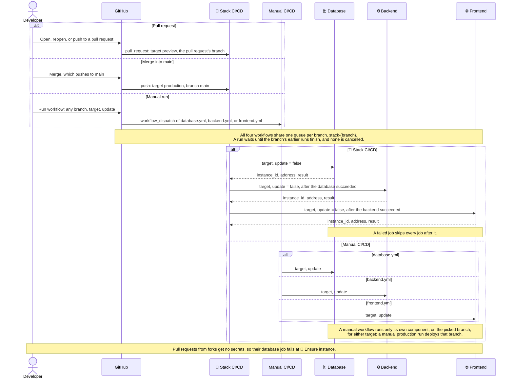

## Pull request lifecycle

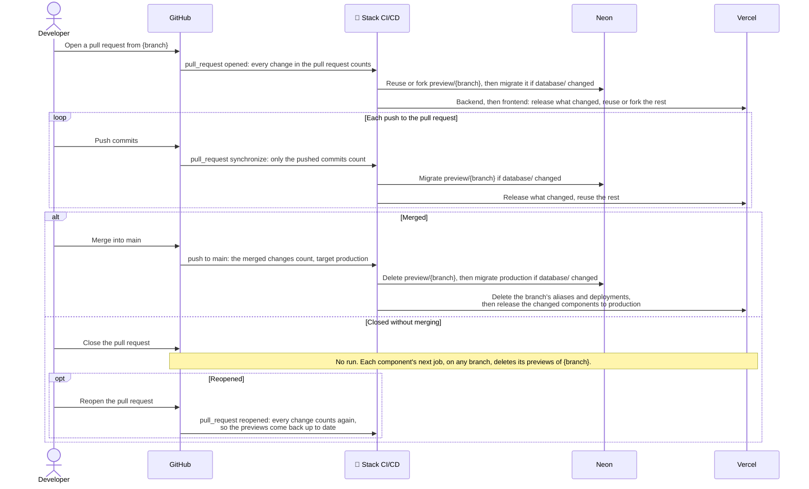

## 🔍 Detect changes

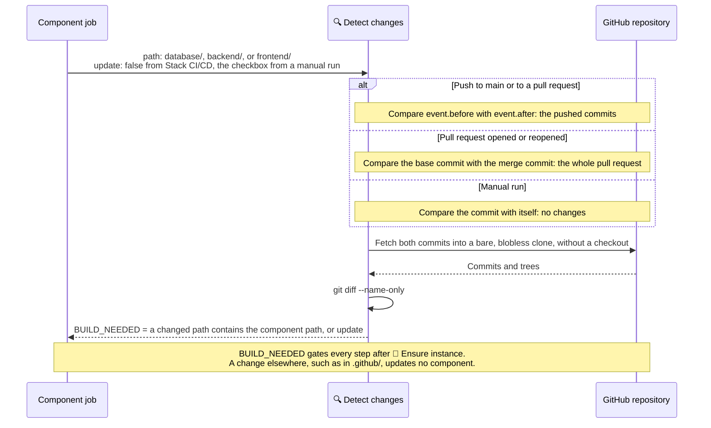

## 🌱 Ensure instance

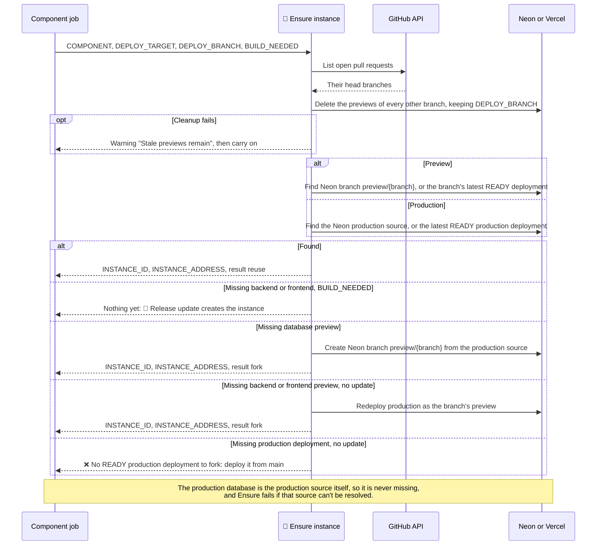

## Preview cleanup

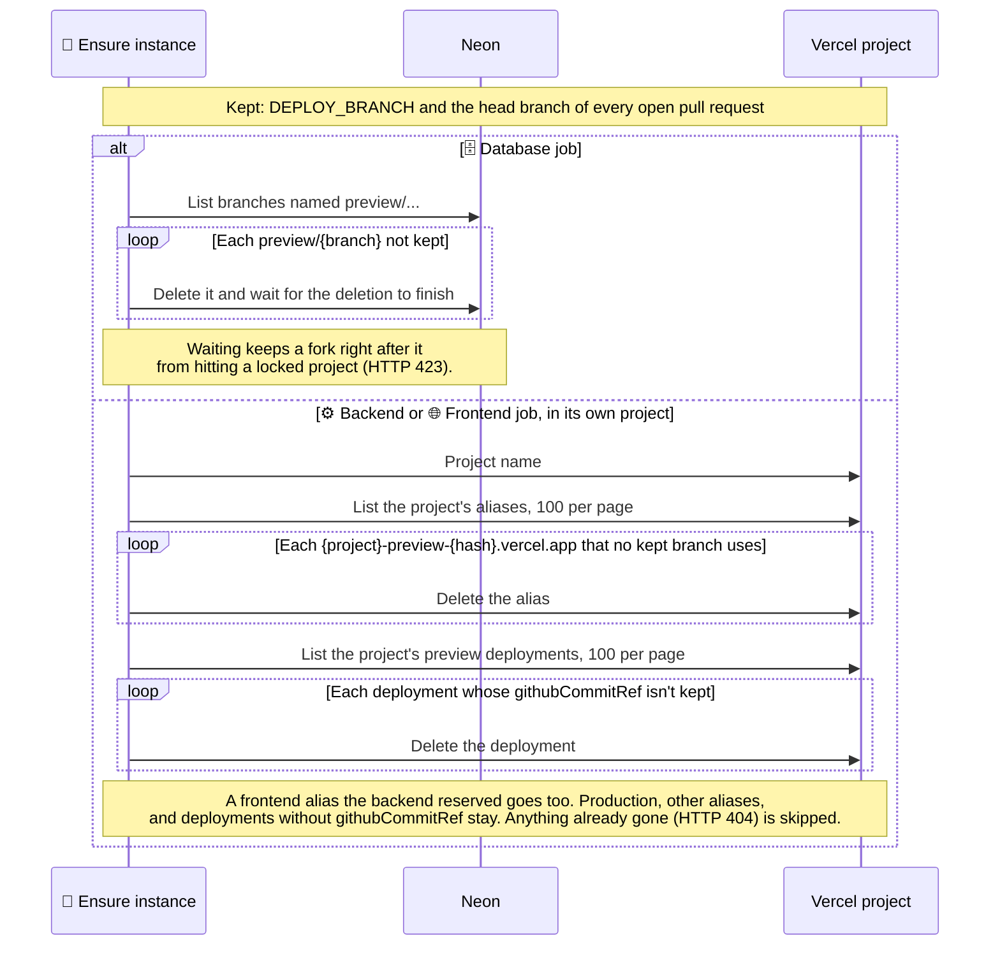

## Forking a backend or frontend preview

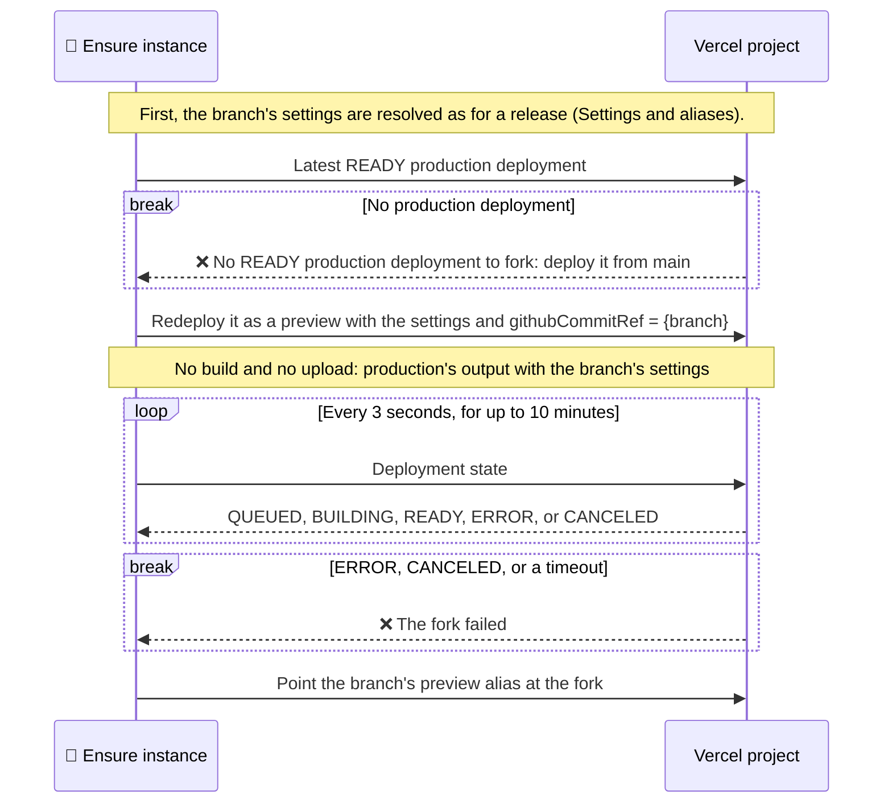

## Settings and aliases

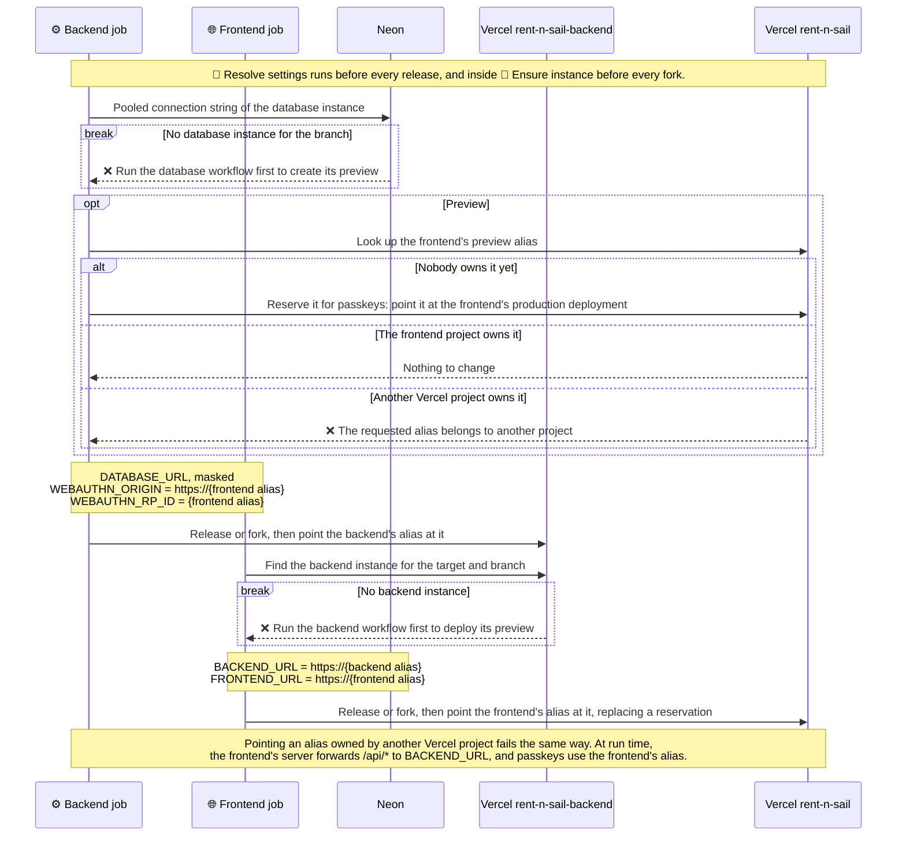

## 🗄️ Database job

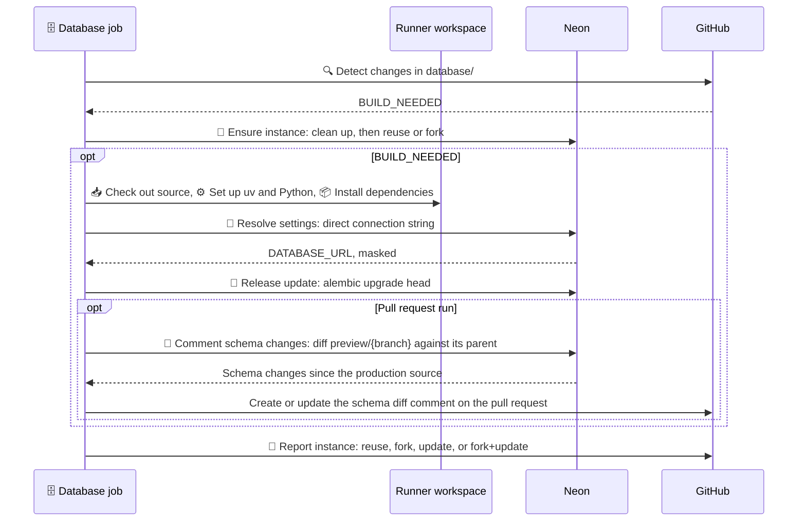

## ⚙️ Backend job

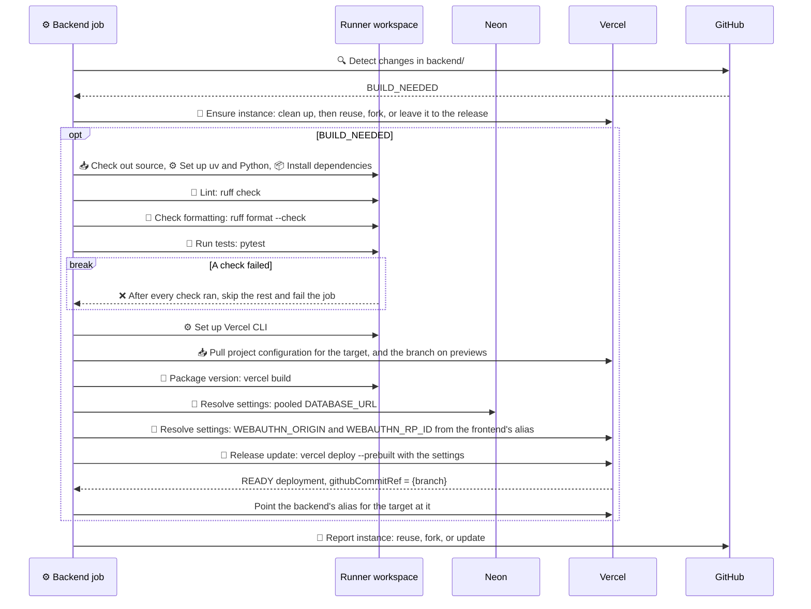

## 🌐 Frontend job

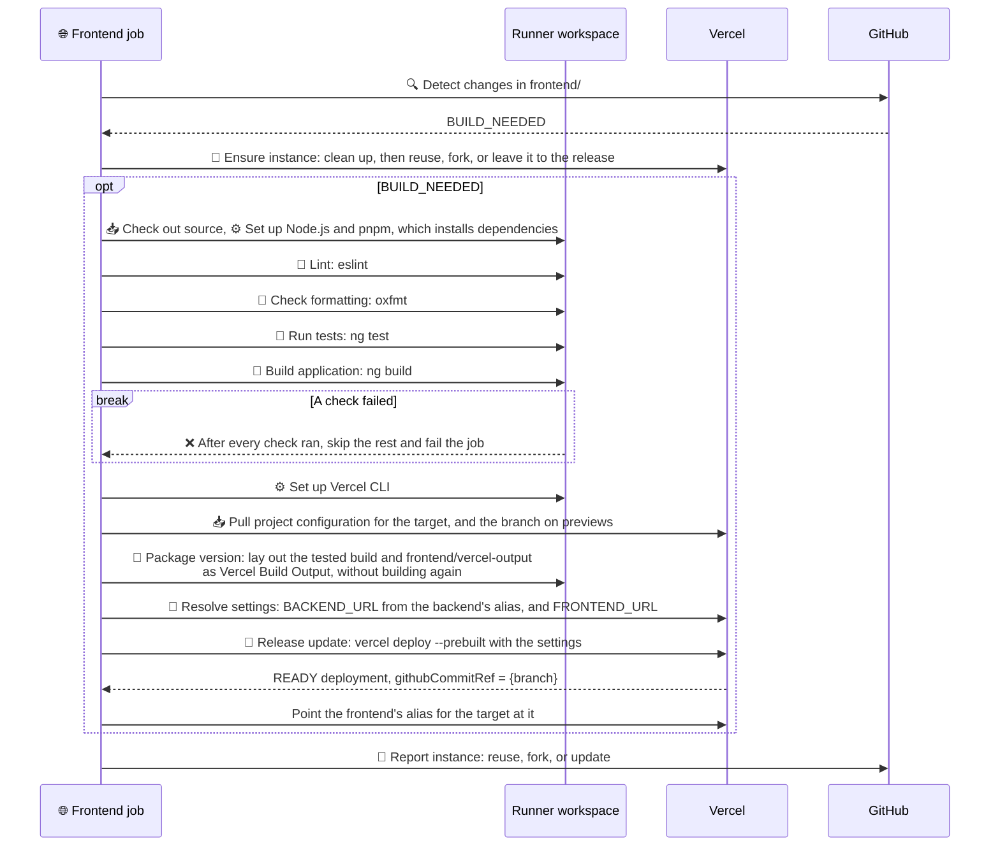

## 📝 Report instance

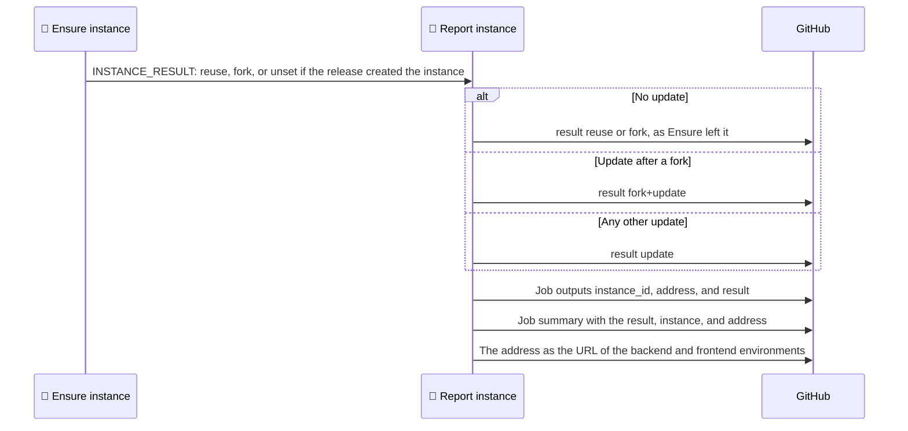

Every combination and its result:

| Component         | Target     | Instance before the run | `BUILD_NEEDED` | 🌱 Ensure instance | Update     | Result      |
| ----------------- | ---------- | ----------------------- | -------------- | ------------------ | ---------- | ----------- |
| Database          | preview    | exists                  | false          | reuse              |            | reuse       |
| Database          | preview    | exists                  | true           | reuse              | migrations | update      |
| Database          | preview    | missing                 | false          | fork               |            | fork        |
| Database          | preview    | missing                 | true           | fork               | migrations | fork+update |
| Database          | production | production source       | false          | reuse              |            | reuse       |
| Database          | production | production source       | true           | reuse              | migrations | update      |
| Backend, frontend | preview    | exists                  | false          | reuse              |            | reuse       |
| Backend, frontend | preview    | exists                  | true           | reuse              | release    | update      |
| Backend, frontend | preview    | missing                 | false          | fork               |            | fork        |
| Backend, frontend | preview    | missing                 | true           | none               | release    | update      |
| Backend, frontend | production | exists                  | false          | reuse              |            | reuse       |
| Backend, frontend | production | exists                  | true           | reuse              | release    | update      |
| Backend, frontend | production | missing                 | false          | ❌ fails           |            |             |
| Backend, frontend | production | missing                 | true           | none               | release    | update      |

## Failures

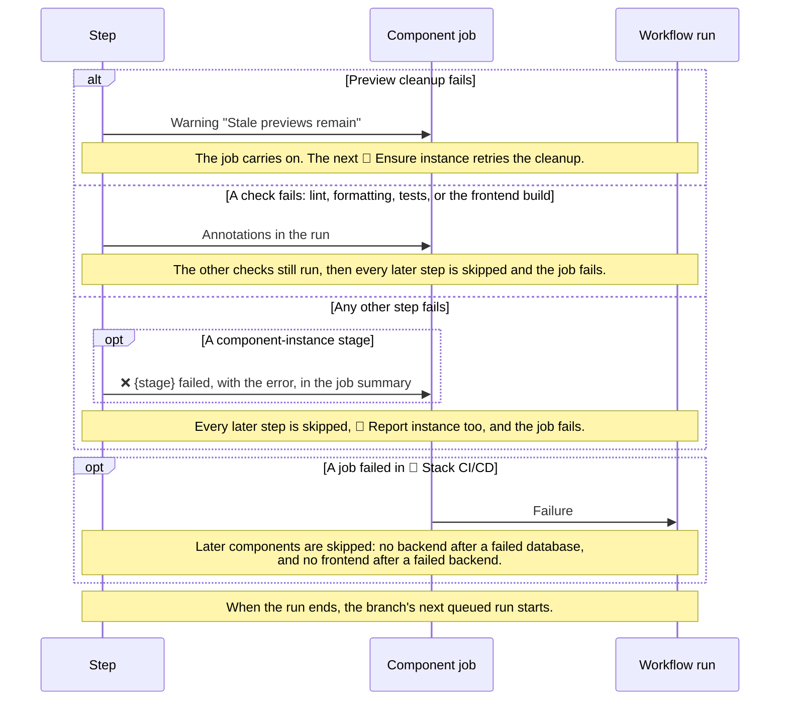
