# CI/CD Pipeline Architecture

This document describes the automated deployment and build infrastructure. The architecture is designed for modularity, allowing for environment-specific deployments (DB, Backend, Frontend) triggered either by the main stack or individual dispatch events.

## Architecture Diagram

```mermaid
flowchart LR
%% STYLOWANIE (Ikona sukcesu na zielono)
classDef success fill:#2da44e,stroke:#2da44e,color:#fff;
classDef successIcon color:#2da44e;

%% 1. STACK
subgraph stack["stack"]
s_start(("On push to main\nor PR")) --> s_db["DB Deploy"]
s_db --> s_be["Backend Deploy"]
s_be --> s_fe["Frontend Deploy"]
s_fe --> s_end(("fa:fa-circle-check"))
class s_end successIcon
end

%% 2. DATABASE SIMPLE
subgraph db_simple["database"]
dbs_start(("on dispatch")) --> dbs_dep["DB Deploy"]
dbs_dep --> dbs_end(("fa:fa-circle-check"))
class dbs_end successIcon
end

%% 3. REUSABLE DATABASE
subgraph r_db["Reusable-database"]
rd_start(("DB Deploy")) --> rd_del["delete stale deployments"]
rd_del --> rd_exist{"DB exist on branch?"}
rd_exist -- "N" --> rd_copy["Copy production DB"]
rd_exist -- "Y" --> rd_choose["Choose existing DB instance"]
rd_copy --> rd_chosen["Chosen DB"]
rd_choose --> rd_chosen
rd_chosen --> rd_det["Detect Changes"]
rd_det --> rd_any{"any changes"}
rd_any -- "Y" --> rd_apply["Apply migrations"]
rd_any -- "N" --> rd_ready(("fa:fa-circle-check DB ready"))
rd_apply --> rd_ready
class rd_ready successIcon
end

%% 4. BUILD DETAIL (DB)
subgraph b_db["Build Detail (DB)"]
bd_start(("build needed")) --> bd_setup["set up uv and python"]
bd_setup --> bd_inst["install dependencies"]
bd_inst --> bd_sett["resolve settings"]
bd_sett --> bd_rel["release update"]
bd_rel --> bd_rep(("report instance"))
end

%% 5. BACKEND SIMPLE
subgraph be_simple["backend"]
bes_start(("on dispatch")) --> bes_dep["backend Deploy"]
bes_dep --> bes_end(("fa:fa-circle-check"))
class bes_end successIcon
end

%% 6. REUSABLE BACKEND
subgraph r_be["Reusable-backend"]
rb_start(("backend Deploy")) --> rb_del["delete stale deployments"]
rb_del --> rb_exist{"backend exist on branch?"}
rb_exist -- "N" --> rb_copy["Copy production backend"]
rb_exist -- "Y" --> rb_choose["Choose existing backend instance"]
rb_copy --> rb_chosen["Chosen backend"]
rb_choose --> rb_chosen
rb_chosen --> rb_det["Detect Changes"]
rb_det --> rb_any{"any changes"}
rb_any -- "Y" --> rb_build["build backend"]
rb_any -- "N" --> rb_ready(("fa:fa-circle-check backend ready"))
rb_build --> rb_ready
class rb_ready successIcon
end

%% 7. BUILD DETAIL (BACKEND)
subgraph b_be["Build Detail (Backend)"]
bb_start(("build needed")) --> bb_setup["set up uv and python"]
bb_setup --> bb_inst["install dependencies"]
bb_inst --> bb_lint["Lint"]
bb_lint --> bb_fmt["Format"]
bb_fmt --> bb_test["run tests"]
bb_test --> bb_verc["set up Vercel CLI"]
bb_verc --> bb_conf["pull configuration"]
bb_conf --> bb_pkg["package version"]
bb_pkg --> bb_sett["resolve settings"]
bb_sett --> bb_rel["release update"]
bb_rel --> bb_rep(("report instance"))
end

%% 8. FRONTEND SIMPLE
subgraph fe_simple["frontend"]
fes_start(("on dispatch")) --> fes_dep["frontend Deploy"]
fes_dep --> fes_end(("fa:fa-circle-check"))
class fes_end successIcon
end

%% 9. REUSABLE FRONTEND
subgraph r_fe["Reusable-frontend"]
rf_start(("frontend Deploy")) --> rf_del["delete stale deployments"]
rf_del --> rf_exist{"frontend exist on branch?"}
rf_exist -- "N" --> rf_copy["Copy production frontend"]
rf_exist -- "Y" --> rf_choose["Choose existing frontend instance"]
rf_copy --> rf_chosen["Chosen frontend"]
rf_choose --> rf_chosen
rf_chosen --> rf_det["Detect Changes"]
rf_det --> rf_any{"any changes"}
rf_any -- "Y" --> rf_build["build frontend"]
rf_any -- "N" --> rf_ready(("fa:fa-circle-check frontend ready"))
rf_build --> rf_ready
class rf_ready successIcon
end

%% 10. BUILD DETAIL (FRONTEND)
subgraph b_fe["Build Detail (Frontend)"]
bf_start(("build needed")) --> bf_setup["set up Node.js and pnpm"]
bf_setup --> bf_lint["Lint"]
bf_lint --> bf_fmt["Format"]
bf_fmt --> bf_test["run tests"]
bf_test --> bf_app["build application"]
bf_app --> bf_verc["set up Vercel CLI"]
bf_verc --> bf_conf["pull configuration"]
bf_conf --> bf_pkg["package version"]
bf_pkg --> bf_sett["resolve settings"]
bf_sett --> bf_rel["release update"]
bf_rel --> bf_rep(("report instance"))
end

%% TRIGGERY (PRZERYWANE STRZAŁKI)
s_db -.-> rd_start
dbs_dep -.-> rd_start
s_be -.-> rb_start
bes_dep -.-> rb_start
s_fe -.-> rf_start
fes_dep -.-> rf_start

rd_apply -.-> bd_start
rb_build -.-> bb_start
rf_build -.-> bf_start
```

